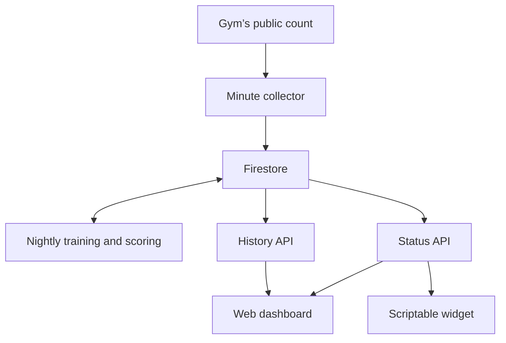

# Climb the Knot

I built Climb the Knot to decide whether to head to the gym now or wait for a quieter session. It tracks crowds at The Knot Climbing Gym in Gainesville, Florida, by saving the gym’s public count once a minute during opening hours. That history powers the crowd estimate, daily forecasts, and weekly heatmap.

[Open the live tracker](https://climbtheknot.live/) · [Install the iPhone widget](https://climbtheknot.live/widgets.html)

## Dashboard

- **Now** shows the gym’s reported count, the last likely staff recount, and an estimate of how many people are inside. The `~` identifies the estimate. Its caption explains which data it uses.
- **Quieter later** highlights a time to go. The chart shows the count so far and the forecast through closing. Use the date picker to see a past day or look ahead.
- **Weekly trends** shows typical reported crowds by weekday and hour. The session planner uses your preferred session length and crowd limit to suggest when to climb.

## Architecture



| Layer | Implementation |
| --- | --- |
| Collection | A scheduled Node.js 22 function polls the [capacity feed](https://climbtheknot.com/api/capacity.json). Each successful poll updates the latest status, the day’s readings, and the weekly aggregates in one [Firestore transaction](functions/index.js). A minute ID guards against duplicate writes on retry. |
| Storage | `system/current` holds the latest reading and forecast, `days/YYYY-MM-DD` holds minute readings, and `system/weekly` holds weekday aggregates. Inferred recounts and saved forecasts have their own records for evaluation. |
| API | [Firebase Hosting](firebase.json) routes `GET /api/status` and `GET /api/history?date=YYYY-MM-DD` to Cloud Functions. The browser and widget use the status API. The dashboard uses the history API when you change dates. |
| Frontend | [HTML, CSS, and JavaScript](public/) render the dashboard and charts. The browser saves planner preferences locally. The [Scriptable widget](public/knot-widget.js) shows the latest available reported count. |

## Occupancy model

### What a drop tells us

The public feed gives one count at a time. It appears to rise as people check in, and it gives no checkout records. When the count falls from 48 to 40, the model treats 40 as a likely staff recount. That eight-person drop could reflect people leaving over several minutes while others checked in. The tracker groups nearby downward steps into one event and marks the final reading. An upward recount is hard to distinguish from check-ins. [Recount detection](functions/recounts.js)

### Estimating the crowd now

The estimate starts with the reported count. When a new drop starts at five people or more and follows a similar correction 20 to 240 minutes earlier that day, the model divides the drop by the elapsed time to update its running rate. After two samples, the model can apply that rate to the time since the latest eligible recount that day. For example, if the feed says **42** and the rate is one person every five minutes, 20 minutes since a recount gives **~38**. The adjustment uses at most 60 minutes of elapsed time. With a live feed and too little evidence for a correction, the panel uses the gym’s count. During a feed interruption, it uses the historical average for that weekday and hour if available, then the last reported count. [Estimate selection](functions/health.js)

### Forecasting later today

The chart starts at the reported count so the forecast continues from the last observed point. Recent movement contributes most near the start. Farther out, the forecast draws on a 15-minute profile trained nightly on up to 60 completed days of inferred recounts. Matching weekdays get more weight, and a day’s weight halves every 28 days. The forecast uses a baseline built from reported counts until there are at least six inferred recounts across three days. Zero at scheduled closing is an assumption. [Forecast model](functions/seasonal.js)

### Checking forecast accuracy

Every 15 minutes, the backend can save forecasts for 15, 30, and 60 minutes ahead. The following morning it scores them by model version against later feed readings and compares their errors with a baseline that holds the starting count steady. It also reports errors against nearby inferred recounts. [Daily scoring](functions/analytics.js)

A separate backtest trains on earlier days, starts at an inferred recount, and checks the forecast against a later recount. At each horizon, 25 comparisons across at least four days are needed to use the 80th percentile of past errors for the shaded range. With less evidence the range is provisional. Both checks rely on the public feed. An independent headcount would be needed to verify the true occupancy. [Backtest and range calibration](functions/seasonal.js)

## Local development

Use Node.js 22 and run these commands from the repository root.

```bash
npm ci --prefix functions
npm test --prefix functions
```

With the Firebase CLI installed, run the integration tests in the local emulators.

```bash
firebase emulators:exec --project demo-knot-launch --only auth,firestore,functions,hosting 'npm run test:emulator --prefix functions'
```

Climb the Knot is an independent project. The gym publishes the underlying count on its [official website](https://climbtheknot.com/).
