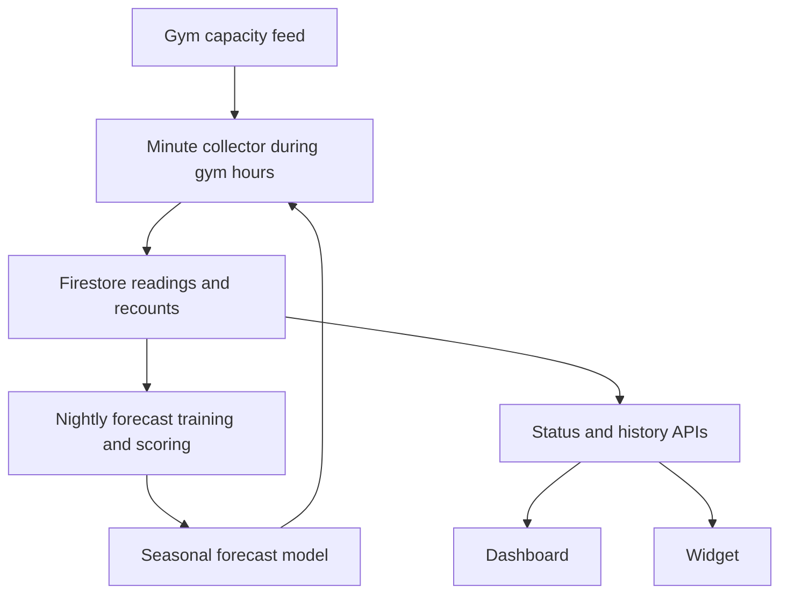

# Climb the Knot

Check how busy The Knot Climbing Gym in Gainesville is now, see quieter hours, and explore past visits by date. This independent tracker uses the gym’s public count. [Open the tracker](https://climbtheknot.live/)

## Reading the numbers

| Dashboard reading | How it works |
| --- | --- |
| Reported count | Latest number from the gym’s public feed. |
| Inferred recount | The count at the end of a downward correction. A drop suggests a staff recount. Its size alone cannot tell us how many people left. |
| Adjusted estimate | Starts with the reported count. After enough recounts, each new reading is adjusted using the learned departure rate and time since the last same-day recount. The correction is capped at one hour of estimated departures. |
| Forecast | Uses historical patterns and recent readings to project occupancy through closing. The scheduled closing count is zero. |

During a feed delay, the estimate uses the historical average for that hour when available, then the last reported count. The panel labels its source. Recount comparisons help tune the model over time.

## How it runs



| Directory | Contents |
| --- | --- |
| `functions/` | Collector and APIs in `index.js`, recount learning in `recounts.js`, estimate selection in `health.js`, seasonal forecasting in `seasonal.js`. Gym hours use Eastern time and are configured in `logic.js`. |
| `public/` | Dashboard, widget guide, opt-in analytics and private admin interface. |
| `tests/` | Model, dashboard and API regression checks. |
| `.github/workflows/` | Tests, Hosting previews, production deployment, branch cleanup and encrypted data export. |

## Development

Use Node.js 22. From the repository root run

```bash
npm ci --prefix functions
npm test --prefix functions
```

For integration checks with the Firebase CLI installed, run

```bash
firebase emulators:exec --project demo-knot-launch --only auth,firestore,functions,hosting 'npm run test:emulator --prefix functions'
```

Pull requests can preview Hosting against production read APIs. Merge to `main` to deploy Hosting and Functions to Firebase project `theknotcapacity`.

## Operations

- **Backups.** Branch cleanup retains the two most recent dated production snapshots and any backup with commits outside `main`. The manual Firestore export workflow backs up occupancy data separately and requires `EXPORT_ENCRYPTION_PASSWORD`.
- **Analytics.** Configure GA4 in `public/launch-config.js` and disable Enhanced Measurement for the tracker stream. Enable Firestore TTL on `expiresAt` for `productVisitors`, `productSessions` and `productEventLimits`.
- **Admin access.** Configure the Firebase web app in `public/admin-config.js`, enable Email/Password sign-in, and grant the administrator the `admin: true` custom claim using the Admin SDK. Contact details are kept separately from feedback.
