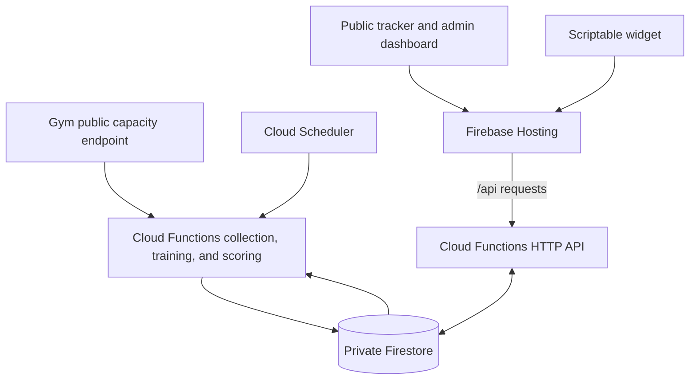
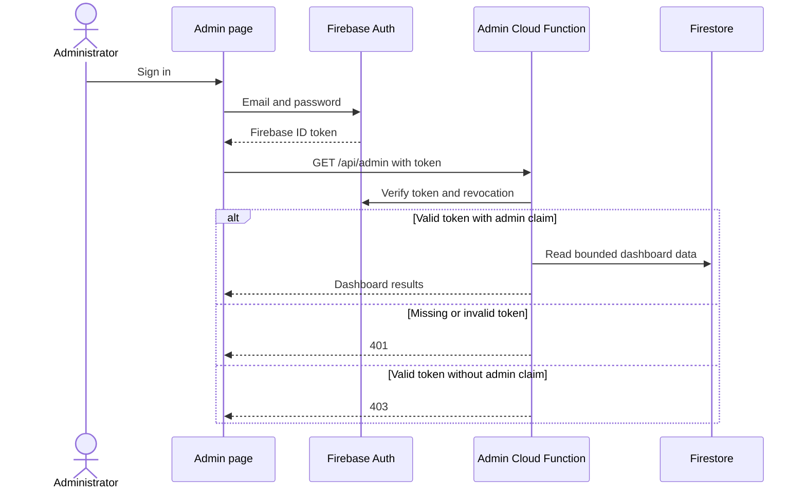
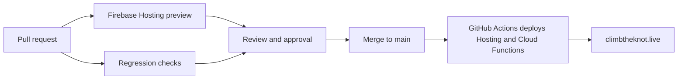

# The Knot Capacity

The Knot Capacity is an independent crowd tracker for The Knot Climbing Gym in Gainesville, Florida. It uses the gym’s public counter to show current conditions, crowd patterns, and forecasts for planning a visit.

[Live tracker](https://climbtheknot.live/) · [Widget and install guide](https://climbtheknot.live/widgets.html) · [Admin sign-in](https://climbtheknot.live/admin.html) · [Official gym website](https://climbtheknot.com/)

## Using the tracker

The black-and-white home page opens with **Reported now** and **Crowd outlook**. **Last recount** shows the ending count of an inferred staff recount with its timestamp. **Adjusted estimate** uses same-day recounts and learned departure rates when the source supports an adjustment. The capacity bar uses 100 as its reference, and the displayed count can exceed 100.

| Section | What you can do |
| --- | --- |
| Reported now and Crowd outlook | Check the reported count, last update, crowd level, recent trend, and Quieter Later. |
| Explore by date | See today’s reported counts and live forecast on one chart. Use the date picker or date shortcuts for past records and future forecasts. Click or tap to inspect individual readings. |
| Find your time to climb | Pick a crowd limit, session length, and time of day. The planner shows up to three non-overlapping forecast sessions, or one typical session from historical averages when needed. |
| Typical week | Explore average reported counts by day and hour. Striped cells indicate closed hours. Use arrow keys to navigate the heatmap. |
| Share and install | Share a timestamped PNG and link using native sharing, clipboard, or download. The install guide covers the iPhone Scriptable widget and device shortcuts. |
| Feedback and settings | Report on-site crowds or send a suggestion. Manage optional analytics, motion, and preferences under **Privacy & settings**. |

The chart uses a white reported line, dashed amber forecast, red recount diamonds, and a green Now marker. The green Open now and Now dots pulse, and the count rolls when it changes. **Reduce motion** or the device setting turns off those animations. The date controls and heatmap support keyboard use. Individual chart readings use pointer selection.

The public counter appears to rise with check-ins. Downward corrections suggest staff recounts, and the ending counts are used as stronger historical observations. The size of a drop does not measure departures. Some recounts may increase the reported count, and the feed alone cannot reliably identify them. Forecasts and occupancy estimates are approximate. Check the [gym’s closure notices](https://climbtheknot.com/closures/) before making a trip.

## Architecture

The browser loads static HTML, CSS, and JavaScript from Firebase Hosting. Hosting rewrites same-origin `/api/*` requests to Cloud Functions, which use the Admin SDK to read and write Firestore. Firestore rules deny direct access from web and mobile clients.



| Location | Responsibility |
| --- | --- |
| `public/index.html`, `app.js`, `history.js`, `chart-controls.js` | Current readings, the combined chart, date browsing, and heatmap |
| `public/member.js`, `experience-model.js`, `launch.js` | Planning, feedback, sharing, consent, and local preferences |
| `public/admin.html`, `admin.js`, `admin-config.js` | Firebase sign-in and the private dashboard |
| `public/widgets.html`, `widgets.js`, `knot-widget.js` | Install instructions, script copy, and the Scriptable widget |
| `functions/index.js`, `health.js`, `logic.js`, `history.js` | Scheduled jobs, source freshness, occupancy logic, and HTTP APIs |
| `functions/recounts.js`, `seasonal.js`, `analytics.js` | Recount grouping, the forecast model, and forecast evaluation |
| `functions/feedback.js`, `product.js` | Feedback and product analytics validation and aggregation |
| `firebase.json`, `firestore.rules`, `.github/workflows/` | Hosting routing, database access, tests, previews, deployments, and exports |

### HTTP routes

| Method and route | Purpose |
| --- | --- |
| `GET /api/status` | Reported count, source freshness, current forecast, and weekly aggregates. Successful responses can be shared-cached for up to 15 seconds, bounded by freshness and the next minute boundary. |
| `GET /api/history?date=YYYY-MM-DD` | Reported history or a forecast for the chosen Eastern date. Accepts dates from 120 days before today through 30 days after today. |
| `POST /api/feedback` | Crowd reports and suggestions. Optional reply contact is stored separately. |
| `POST /api/event` | Consent-gated first-party product events. |
| `GET /api/admin` | Private analytics, recent feedback, source health, and forecast scores. Requires a Firebase ID token with the `admin` claim. |

The browser submits feedback and product events from `https://climbtheknot.live`. Both endpoints validate payloads and cap accepted traffic. Admin responses and date history use `Cache-Control: no-store`.

### Collection, forecasts, and storage

All scheduled times are Eastern. `collectOccupancy` runs every minute and fetches the source during configured gym hours. `scoreOccupancyForecasts` evaluates yesterday’s frozen forecasts at 2:15 AM. `trainSeasonalForecast` refreshes the seasonal model at 4:20 AM from up to 60 completed days. Regular hours are set in `functions/logic.js` under `HOURS`. The zero at scheduled closing is a model assumption.

The live forecast starts from the latest reported count. V4 uses a learned recount profile with enough completed history and falls back to the legacy model otherwise. Forecast bands use observed errors when coverage and sample size support them. Quieter Later skips closing-taper windows and forecast gaps. The planner checks both average and peak occupancy across each proposed session.

| Firestore paths | Data |
| --- | --- |
| `system/current`, `system/weekly` | Current source reading, health, forecast, and weekly time aggregates |
| `system/seasonalModel`, `system/forecastAccuracy` | Trained profile, backtest, and latest scored forecasts |
| `days/{date}`, `dailySummaries`, `recountEvents` | Minute readings, 15-minute summaries, and inferred recounts |
| `forecastSnapshots`, `forecastScores` | Frozen predictions and versioned daily scores |
| `memberFeedback`, `feedbackContacts`, `feedbackLimits` | Feedback, optional contact in a separate collection, and submission limits |
| `productDaily`, `productVisitors`, `productSessions`, `productEventLimits` | Pseudonymous browser activity aggregates, sessions, and event limits |

The collector updates a growing daily document and cumulative weekly aggregates. Any future change to those document layouts should account for the history, training, and export readers.

## Admin sign-in

Use [climbtheknot.live/admin.html](https://climbtheknot.live/admin.html) for the dashboard. The Hosting config includes redirects from `/admin` and `/admin/`. If a deployment still returns **Page not found** at a short address, open the full `/admin.html` URL.



- The public web app config is in `public/admin-config.js`. In Firebase Authentication, enable **Email/Password** and create the account under **Users**. A project administrator assigns the `admin: true` custom claim by UID using the Firebase Admin SDK. Sign out and back in after a claim change to get a fresh token.
- Firebase Hosting previews are for reviewing the interface. Admin sign-in is enabled on the production origin. A preview message that access is disabled is expected.
- Dashboard counts are daily distinct browsers, sessions, and events. The dashboard also shows recent feedback, forecast accuracy, and source health. Daily visitor counts cannot be summed to get unique people across days. Feedback contacts remain in the separate Firestore collection.

## Analytics and feedback

The production tracker loads the direct Google tag after a visitor opts in under **Privacy & settings**. The GA4 stream ID is in `public/launch-config.js`. The tracker sends `page_view` and feature events such as `plan_view`. Enhanced Measurement is optional and can add automatic events after the tag loads. Keep automatic history-based page views off if you want page views to reflect the tracker’s explicit events.

First-party analytics use a random browser ID and a 30-minute inactivity session. They group activity into broad channels such as share, install, print, referral, and direct. Firestore TTL policies can use the existing `expiresAt` fields on `productVisitors`, `productSessions`, and `productEventLimits`, with records written for 90, 7, and 2 days respectively. Actual deletion requires enabling TTL in Firestore. Daily aggregate and feedback retention are separate operational settings.

Crowd reports require on-site confirmation and are accepted during configured gym hours. The feedback endpoint enforces a 10-minute browser cooldown and 200 submissions per Eastern day. Optional contact details are used for follow-up and excluded from the admin dashboard results.

## Develop and release

Use Node.js 22. Install dependencies and run the regression suite from the repository root.

```bash
npm ci --prefix functions
npm test --prefix functions
```

Run the smoke test against the isolated emulator project. It checks endpoint routing, authorization, date bounds, feedback contact separation, and event deduplication.

```bash
firebase emulators:exec --project demo-knot-launch --only auth,firestore,functions,hosting 'npm run test:emulator --prefix functions'
```



The preview uses production read APIs and disables admin sign-in, analytics, and feedback in the UI. Merges to `main` trigger production deployment to the `theknotcapacity` Firebase project. Use the GitHub Actions deploy secret for CI, and keep service-account credentials and local secrets outside the repository.

After a release, verify the live site and date chart, confirm the admin sign-in page opens, and check that an unauthenticated request to `/api/admin` returns `401`. With an authorized account, verify the dashboard loads. After opting in on the live tracker, open **Plan** and look for the intended events in GA4 Realtime.

The main tracker and widget guide are public and listed in the [sitemap](https://climbtheknot.live/sitemap.xml). The admin page sends `noindex, nofollow` and uses the same authentication gate regardless of how visitors reach it.

### Backups and rollback

Git branches under `backup/` preserve historical releases. The [pre-launch backup](https://github.com/NolanHasting/the-knot-capacity/tree/backup/production-2026-11-18-before-launch) records the previous production code before the redesigned tracker went live. For a code rollback, review the difference against the desired release and revert through the normal production workflow.

Use the manual **Export historical Firestore occupancy data** workflow for a data backup. It uses `EXPORT_ENCRYPTION_PASSWORD` to encrypt the archive before uploading it.
