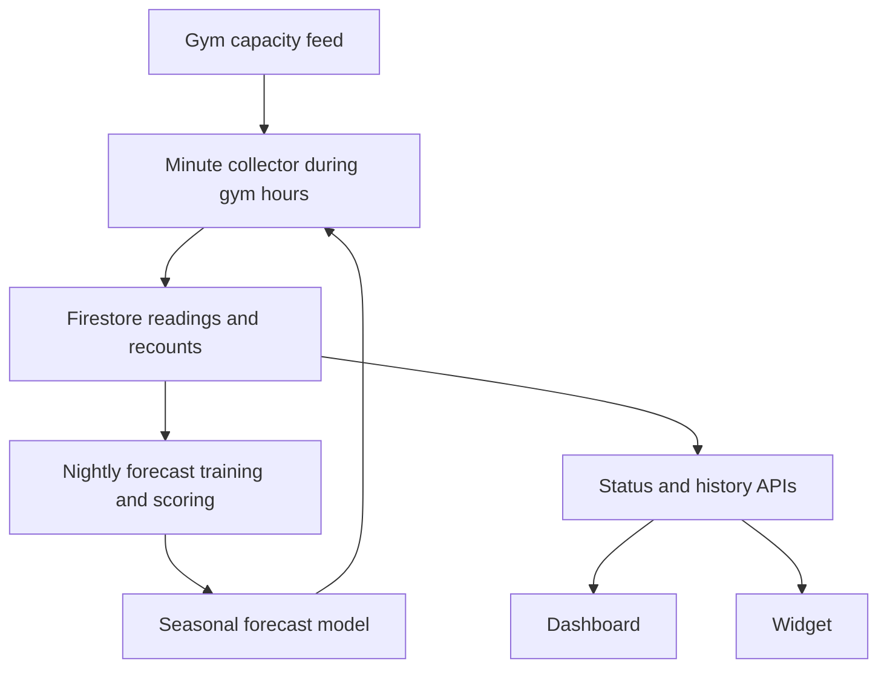

# Climb the Knot

How many people are climbing right now, and would it be quieter to go later? Climb the Knot is an independent occupancy research project for The Knot Climbing Gym in Gainesville, Florida. It turns the gym’s public count into a live dashboard, a searchable history by date, and a forecast through closing. [Open the tracker](https://climbtheknot.live/)

## What the counter can tell us

The feed publishes one number at a time. A change from 40 to 41 is visible, but the feed gives no arrival or departure records to explain it. The project treats a downward correction as a likely staff recount. Several downward steps close together can belong to one recount, so the tracker marks the **ending count** once. A correction from 48 to 40 gives the model a reference point of 40. Exactly when people left, or whether anyone arrived during the correction, remains unknown.

| Dashboard reading | What it tells a climber |
| --- | --- |
| Gym’s reported count | The latest count supplied by the gym. The connection indicator shows whether the feed is current. |
| Likely recount | The ending count and time of the latest inferred correction that day, when the feed is live. |
| Estimated people inside | An estimate for right now. The note beneath it identifies whether it uses the gym’s count, a departure adjustment, or an older source. |
| Crowd outlook | How the reported count may change over the rest of the day. The forecast starts at the gym’s reported count. |

## Estimating how many people are inside

The estimate starts with each new live reading. To learn how much the counter tends to drift, the model looks for recount episodes that begin with a drop of at least five people. When two qualifying starts fall 20 to 240 minutes apart on the same day, it divides the new drop by the elapsed minutes. It caps that sample at two people per minute and, after the first sample, gives each new sample 20% weight in the running rate.

After two rate samples, the tracker can apply that rate to the time since the latest matching recount that day. For example, if the gym reports 42 and the learned rate is 0.2 people per minute, 20 minutes since a recount gives an estimate of **38 people inside**. The correction stops growing after 60 minutes, and the result is rounded and bounded at zero. This is an inference about counter drift. The feed alone cannot verify individual departures.

With too little evidence, the panel uses the gym’s live count. During a feed delay, it uses the historical average for that weekday and hour if available, then the last reported count. Outside scheduled hours it shows zero.

## From readings to crowd patterns

- **Weekly patterns.** Each reading contributes to an hourly and a 15-minute bucket for its weekday in Eastern time. These summaries describe what the gym typically *reports*. A busy hour with frequent check-ins can look different in the weekly heatmap and the recount-based forecast.
- **Recent movement.** The tracker uses up to 45 minutes of readings to estimate change per 30 minutes. A drop between readings at most three minutes apart starts a fresh trend segment. A trend needs at least three readings spanning ten minutes.
- **Forecast through closing.** Nightly training builds a 15-minute profile for each weekday from inferred recounts in the preceding 60 completed days. Each day contributes at most once per slot. Matching weekdays receive more weight, and a day’s weight halves every 28 days. The collector switches from its weekly baseline forecast to this profile once training includes at least three days and six recounts. Recent movement matters most near the start. Further out, the forecast gives more weight to the historical change expected over that interval. Zero at scheduled closing is an assumption.

## How the forecast is evaluated

A nightly job scores saved forecasts against the following observations and stores results by model version. A separate walk-forward backtest asks a narrower question. Starting from a recount on a past day, how close would a forecast trained only on earlier days have come to a later recount? This test starts with no live trend, so its errors describe forecasts made from those recount starting points.

The backtest groups absolute errors, measured in people, by forecast horizon from 15 minutes to eight hours. For a horizon with at least 25 comparisons across four days, the model uses the 80th percentile of those errors to size the shaded range. Where calibration data are sparse, it uses a provisional range. Recounts are inferred and can be unevenly distributed across the day. The band therefore describes uncertainty relative to available recounts, and actual coverage can vary by hour.

## How it runs



| Directory | Contents |
| --- | --- |
| `functions/` | Collector and APIs in `index.js`, recount learning in `recounts.js`, estimate selection in `health.js`, seasonal forecasting in `seasonal.js`. Gym hours use Eastern time and are configured in `logic.js`. |
| `public/` | Dashboard, widget guide, opt-in analytics and private admin interface. |
| `tests/` | Model, dashboard and API regression checks. |
| `.github/workflows/` | Tests, Hosting previews, production deployment, branch cleanup and encrypted data export. |

## Development

Use Node.js 22. From the repository root run

```bash
npm ci --prefix functions
npm test --prefix functions
```

For integration checks with the Firebase CLI installed, run

```bash
firebase emulators:exec --project demo-knot-launch --only auth,firestore,functions,hosting 'npm run test:emulator --prefix functions'
```

Pull requests can preview Hosting against production read APIs. Merge to `main` to deploy Hosting and Functions to Firebase project `theknotcapacity`.

## Operations

- **Backups.** Branch cleanup retains the two most recent dated production snapshots and any backup with commits outside `main`. The manual Firestore export workflow backs up occupancy data separately and requires `EXPORT_ENCRYPTION_PASSWORD`.
- **Analytics.** Configure GA4 in `public/launch-config.js` and disable Enhanced Measurement for the tracker stream. Enable Firestore TTL on `expiresAt` for `productVisitors`, `productSessions` and `productEventLimits`.
- **Admin access.** Configure the Firebase web app in `public/admin-config.js`, enable Email/Password sign-in, and grant the administrator the `admin: true` custom claim using the Admin SDK. Contact details are kept separately from feedback.
